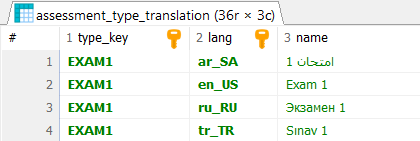
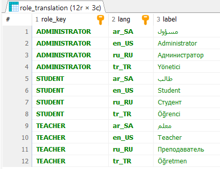
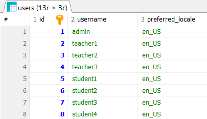

# Database Localization Plan and Implementation Report

## Software Engineering Project 1 – Sprint 6

**Project:** EduJournal – Teacher's Gradebook and Report Card System  
**Sprint:** Sprint 6 – Database Localization, Code Review, Code Clean-Up, and Acceptance Testing  
**Team Members:** Bayram Erdogan, Grigorii Tishchuk, Olena Petrova, Maria Kuznetsova  
**Date:** 17 November 2026

---

# 1. Introduction

The purpose of database localization is to enable the EduJournal system to support multiple languages not only within the user interface but also within database-driven content. The implementation ensures that multilingual data can be stored, retrieved, and displayed according to the user's selected language.

Database localization was introduced to support:

- English
- Russian
- Turkish
- Arabic

The implementation focuses on scalability, maintainability, and compliance with internationalization best practices.

---

# 2. Localization Requirements

The following requirements were identified for database localization:

- Support multilingual content retrieval.
- Store user language preferences.
- Support Unicode character sets.
- Allow future language additions without database redesign.
- Provide fallback behaviour when translations are unavailable.
- Maintain compatibility with the existing localization framework.

---

# 3. Selected Localization Strategy

A translation-table approach was selected.

This approach separates business data from translated content, improving maintainability and making future language expansion straightforward.

The implementation includes dedicated localization tables containing translation entries for supported languages.

### Advantages

- Scalable architecture
- Easy language expansion
- No duplication of business data
- Consistent localization management
- Simplified maintenance and updates

---

# 4. Database Localization Architecture

## User Locale Persistence

The selected language is stored in the database using the following field:

```text
users.preferred_locale
```

This allows the application to automatically restore the user's preferred language after login.

### Example Values

| preferred_locale |
|------------------|
| en_US |
| ru_RU |
| tr_TR |
| ar_SA |

---

## Assessment Type Localization

Assessment types are localized using a translation table.

### Table Structure

```text
assessment_type_translation
```

| Column | Description |
|----------|----------|
| type_key | Internal assessment identifier |
| lang | Language code |
| name | Localized assessment name |

### Example

| type_key | lang | name |
|----------|------|----------|
| EXAM | en | Exam |
| EXAM | ru | Экзамен |
| EXAM | tr | Sınav |
| EXAM | ar | اختبار |

---

## Role Label Localization

Role names are localized through a dedicated translation table.

### Table Structure

```text
role_translation
```

| Column | Description |
|----------|----------|
| role_key | Internal role identifier |
| lang | Language code |
| label | Localized role label |

### Example

| role_key | lang | label |
|----------|------|----------|
| TEACHER | en | Teacher |
| TEACHER | ru | Преподаватель |
| TEACHER | tr | Öğretmen |
| TEACHER | ar | معلم |

---

# 5. Character Encoding Configuration

To ensure full multilingual compatibility, the database uses Unicode encoding.

## Configuration

```text
Character Set: utf8mb4
Collation: utf8mb4_unicode_ci
```

### Benefits

- Full Unicode support
- Arabic script support
- Cyrillic support
- Turkish special characters
- Future multilingual scalability

The selected configuration guarantees correct storage and retrieval of data across all supported languages.

---

# 6. Locale Retrieval and Application Logic

When a user logs into the system:

1. The application reads the user's `preferred_locale`.
2. The locale is loaded into the localization subsystem.
3. Localized database values are retrieved for the selected language.
4. UI resources and database-driven translations are displayed consistently.

If a translation is unavailable, the system automatically falls back to English.

---

# 7. Validation and Testing

Localization functionality was validated using all supported languages.

## Test Scenarios

### Locale Persistence

Verified that selected languages are stored and restored after user login.

### Assessment Type Localization

Verified that assessment types display correctly for:

- English
- Russian
- Turkish
- Arabic

### Role Localization

Verified that role labels are displayed correctly in:

- Navigation components
- Profile pages
- Dashboard views

### UTF-8 Validation

Verified proper storage and retrieval of:

- Latin characters
- Cyrillic characters
- Turkish special characters
- Arabic script

### Fallback Behaviour

Verified that English translations are used when localized values are unavailable.

---

# 8. Localization Validation Evidence

### Database Localization Example



Figure 1. Database localization tables and multilingual content.

---

### Localized Role Labels



Figure 2. Localized role labels retrieved from the database.

---

### User Locale Persistence



Figure 3. User language preference stored and restored from the database.

---

# 9. Results

The database localization objectives were successfully achieved.

Implemented functionality includes:

- UTF-8 database support
- Locale persistence through user preferences
- Translation-table architecture
- Localized assessment types
- Localized role labels
- Automatic English fallback
- Multilingual data validation

The implemented solution supports future language additions with minimal database or application changes.

---

# 10. Conclusion

Database localization was successfully integrated into the EduJournal system. The selected translation-table approach provides a scalable and maintainable foundation for multilingual content management.

The implementation ensures correct encoding, reliable language persistence, localized database content retrieval, and compatibility with the existing application localization framework. The solution is fully prepared for future expansion and long-term maintenance.