# EduJournal - Sprint 7 Heuristic Evaluation

**Project:**: EduJournal - Teacher's Gradebook and Report Card System  
**Sprint:** 7 - Project Testing, Functional and Non-functional Testing

---

## 1. Overview

This report presents the heuristic evaluation of the EduJournal JavaFX desktop application.
The evaluation is based on **Nielsen's 10 Usability Heuristics**. Each finding is recorded with
the affected screen, the violated heuristic, a description of the problem, severity rating,
and a recommendation.

### Severity Scale

| Rating | Description |
|:---:|---|
| 0 | Not a usability problem |
| 1 | Cosmetic issue - fix only if time permits |
| 2 | Minor usability problem - low priority |
| 3 | Major usability problem - important to fix |
| 4 | Usability catastrophe - must fix before release |

---

## 2. Nielsen's 10 Heuristics - Reference

| # | Heuristic |
|:---:|---|
| H1-1 | Simple & natural dialog |
| H1-2 | Speak the users' language |
| H1-3 | Minimize users' memory load |
| H1-4 | Consistency |
| H1-5 | Feedback |
| H1-6 | Clearly marked exits |
| H1-7 | Shortcuts |
| H1-8 | Precise & constructive error messages |
| H1-9 | Prevent errors |
| H1-10 | Help and documentation |

---

## 3. Screens Evaluated

| Screen | Role |
|---|---|
| Login Page | All users |
| Admin Dashboard | Admin |
| Admin - Student Management | Admin |
| Admin - Teacher Management | Admin |
| Admin - Group Management | Admin |
| Teacher Dashboard | Teacher |
| Teacher Gradebook - Assessments Tab | Teacher |
| Teacher Gradebook - Grades Tab | Teacher |
| Teacher Gradebook - Notes Tab | Teacher |
| Student Dashboard | Student |
| Course Report Page | Teacher / Admin |
| Student Report Page | Admin / Student |
| Own Profile Page | All users |

---

## 4. Findings

| ID | Screen | Heuristic | Description                                                                                                                                                                                                                                                    | Screenshot | Severity | Recommendation | Status |
|---|---|:---:|----------------------------------------------------------------------------------------------------------------------------------------------------------------------------------------------------------------------------------------------------------------|:---:|:---:|---|---|
| HE-01 | Admin - Course / Group Management | H1-1: Simple & natural dialog | Required fields are not clearly marked in the course and group creation forms - users may only discover missing information after submitting the form                                                                                                          | 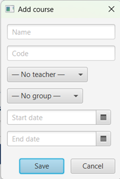 | 2 | Clearly mark required fields with a visual indicator so users know what is mandatory before submitting | Open |
| HE-02 | Admin - Course / Group Management | H1-3: Minimize users' memory load | Entered data is not preserved after a validation error during course or group creation - the form closes and users must reopen it and re-enter all information                                                                                                 | 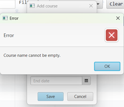 | 2 | Keep the form open and preserve entered data when a validation error occurs | Open |
| HE-03 | Teacher Gradebook - Assessments Tab | H1-4: Consistency | Editing an existing assessment does not apply a position change - the position field is shown and pre-filled in the edit form but its value is silently ignored on save                                                                                        | 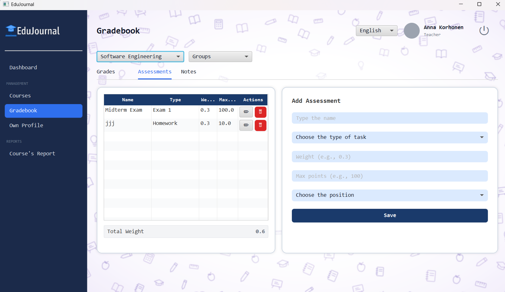 | 2 | Read the position field value during update and move the assessment to the selected position in the list | Fixed |
| HE-04 | Admin - Student / Teacher / Course / Group Management | H1-4: Consistency | Creation forms behave inconsistently after validation errors - student and teacher forms remain open allowing the user to correct input, while group and course forms close and require the user to reopen them                                                | 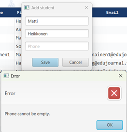 | 2 | Make all creation forms behave consistently by keeping them open when a validation error occurs | Open |
| HE-05 | Admin - Student / Teacher / Course / Group Management | H1-5: Feedback | No confirmation message is shown after adding, editing, or deleting a record - the table updates immediately so the change is visible, but there is no clear success notification. Users can only verify that an action succeeded by checking the updated list | 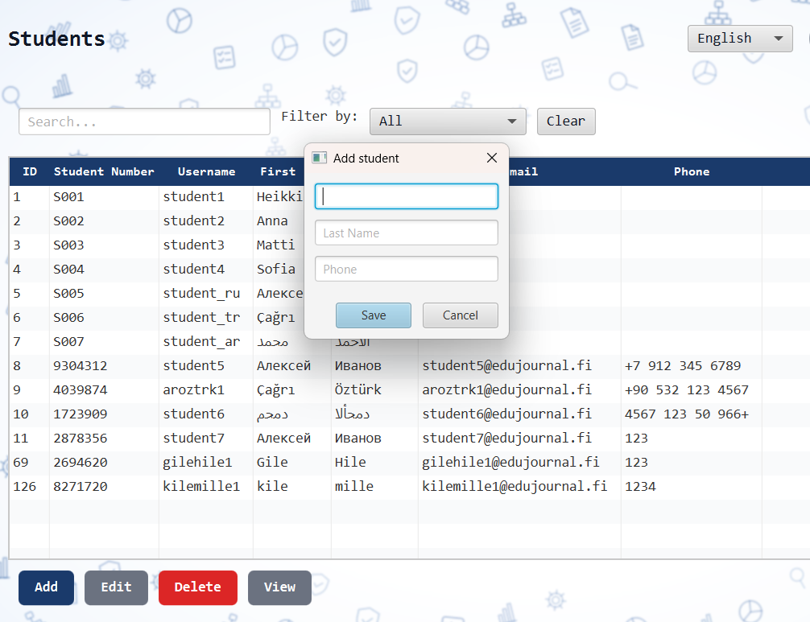 | 2 | Add a brief status message (e.g. "Student saved") after each create, edit, or delete action | Open |
| HE-06 | Course Report Page | H1-5: Feedback | After exporting a gradebook to PDF or CSV, no confirmation or file path is shown - user does not know if the export succeeded or where the file was saved                                                                                                      | 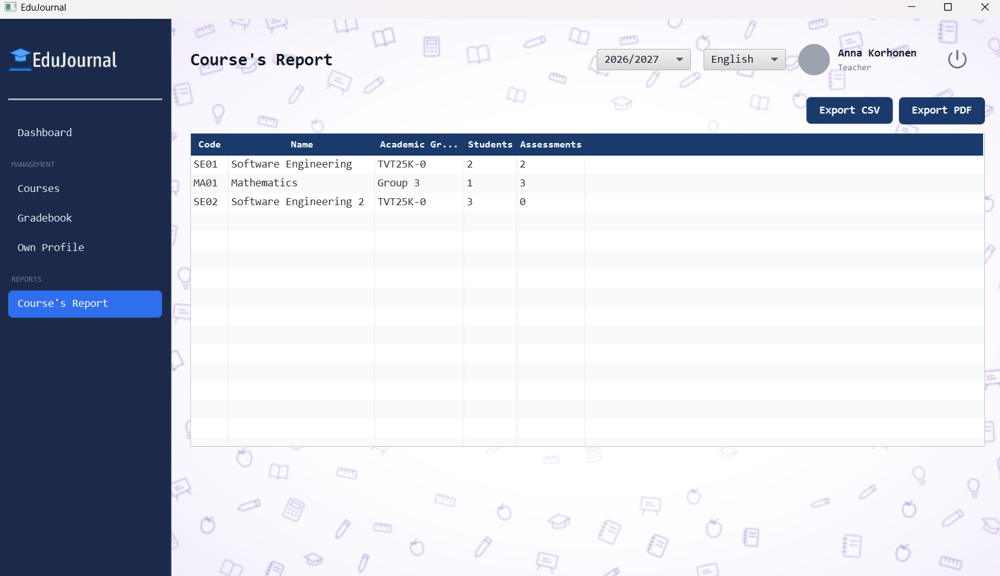 | 2 | Display a success message with the saved file location after export completes | Open |
| HE-07 | Teacher Gradebook - Grades Tab | H1-5: Feedback | Final grade column shows "-" with no explanation when a student is missing one or more assessment grades - user does not know why the grade is absent or what action is required                                                                               | 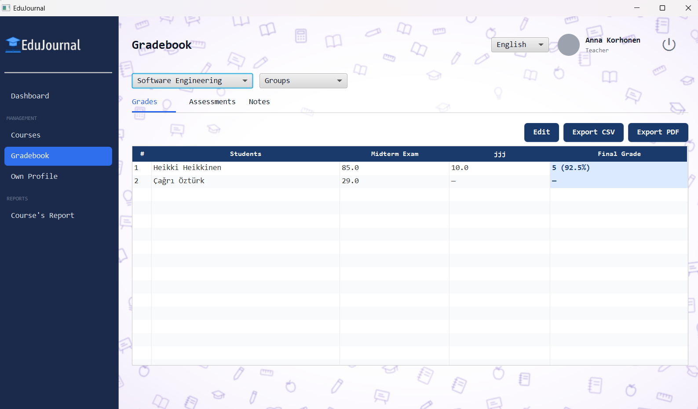 | 1 | Show a tooltip on "-" cells explaining that the final grade appears once all assessment grades are filled in | Fixed |
| HE-08 | Student Report Page | H1-5: Feedback | Final grade column shows "-" with no explanation when assessment grades are incomplete - student does not know what action is required to see the grade                                                                                                        |  | 1 | Show a tooltip on "-" cells explaining that the final grade appears once all assessment grades are filled in | Fixed |
| HE-09 | Own Profile Page | H1-6: Clearly marked exits | No Cancel button is available while editing profile fields - it is not clear to the user that navigating away will discard unsaved changes, with no clear way to cancel                                                                                        | 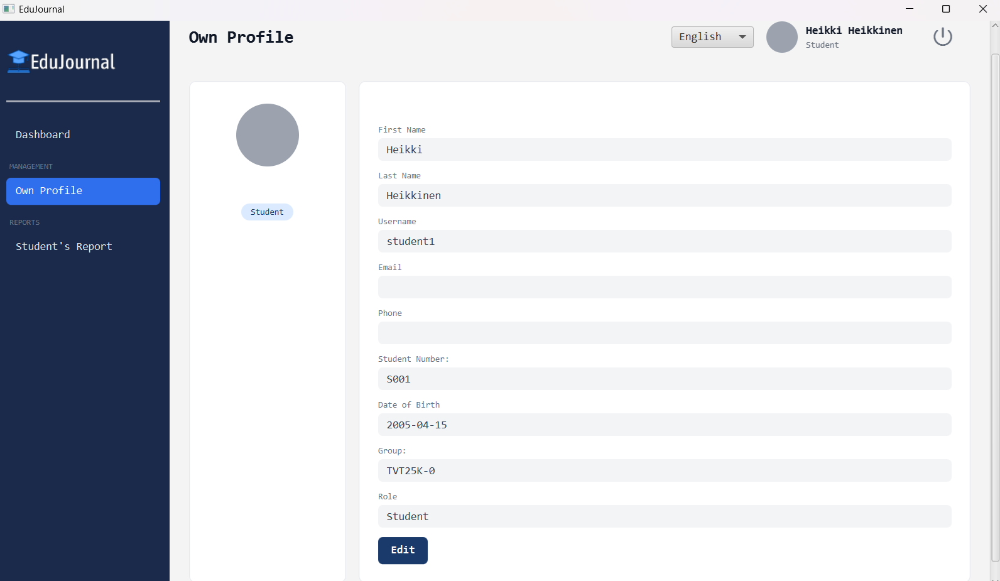 | 1 | Add a Cancel button that restores original field values and exits edit mode without saving | Fixed |
| HE-10 | Teacher Gradebook - Grades Tab | H1-6: Clearly marked exits | No Cancel button available while editing grades - it is not clear to the teacher that navigating away will discard unsaved changes, with no clear way to cancel                                                                                                | 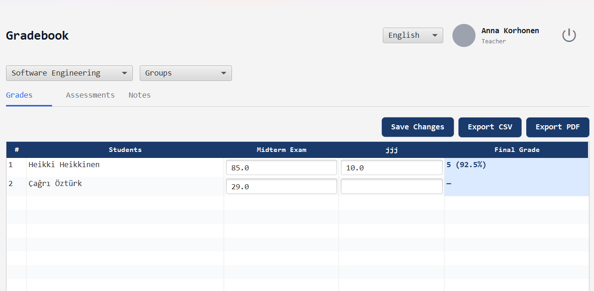 | 1 | Add a Cancel button that restores original grade values and exits edit mode without saving | Fixed |
| HE-11 | Admin - Dashboard / All Management screens | H1-6: Clearly marked exits | Cancel button does not return the user to the page where they started the operation - clicking Cancel from an add form opened via the Dashboard redirects to a different page instead of back to the Dashboard | 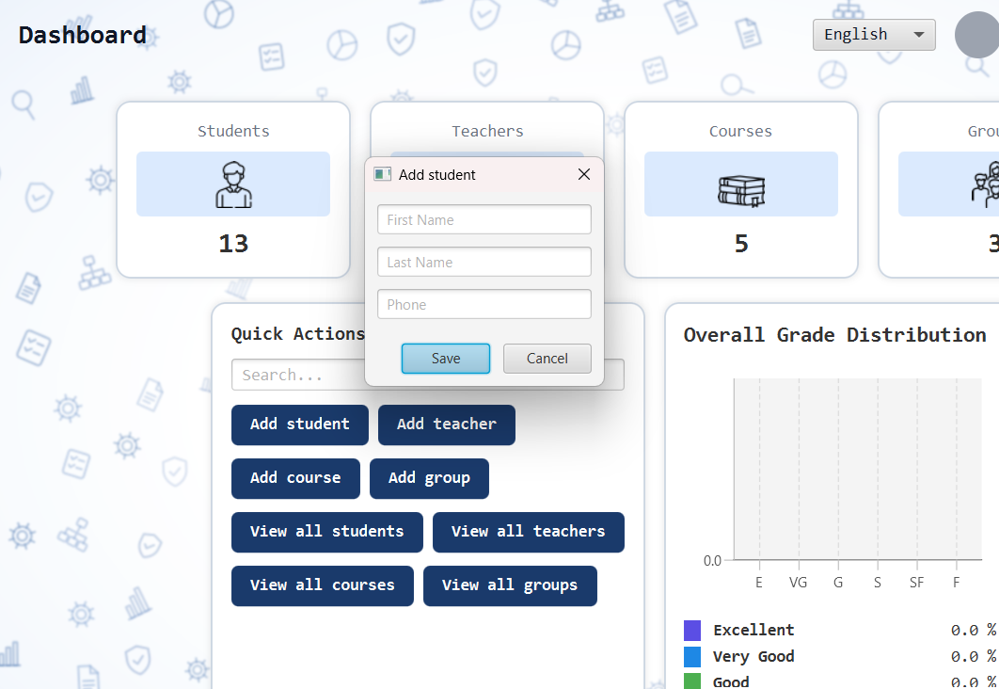 | 2 | Cancel button should return the user to the page from which they started the operation | Open |
| HE-12 | Login Page | H1-7: Shortcuts | Pressing Enter on the username field does not move focus to the password field - user must click with the mouse                                                                                                                                                | 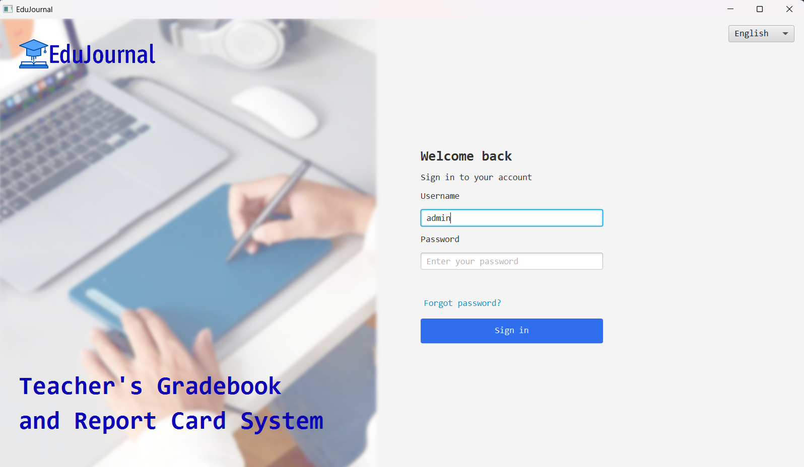 | 1 | Set the username field's action to transfer focus to the password field on Enter | Open |
| HE-13 | Login Page | H1-7: Shortcuts | Pressing Enter on the password field does not submit the form - user must click the Sign In button with the mouse                                                                                                                                              | 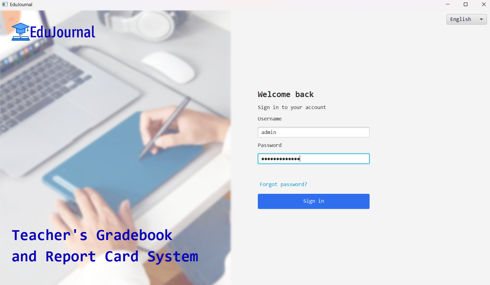 | 1 | Bind Enter key on the password field to trigger the login action | Open |
| HE-14 | Teacher Gradebook - Grades Tab | H1-8: Precise & constructive error messages | After entering an invalid grade and dismissing the alert, the form exits edit mode - valid grades entered in the same session are saved but the teacher cannot correct the invalid value without re-entering edit mode                                         | 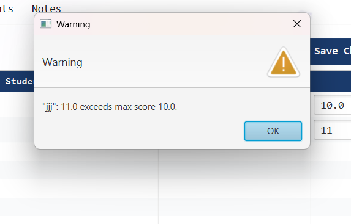 | 2 | Keep the form in edit mode when a validation error occurs so the teacher can fix the invalid value and continue | Fixed |
| HE-15 | Login Page | H1-9: Prevent errors | Forgot Password allows any user to reset any other user's password without identity verification - no current user credentials or confirmation required                                                                                                        | 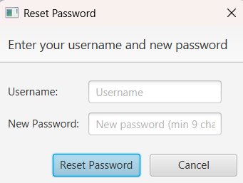 | 3 | Require the current user to confirm their identity (e.g. current password or admin approval) before a password change is accepted | Fixed |
| HE-16 | Admin - Student / Teacher / Course / Group Management | H1-9: Prevent errors | Users can submit creation forms with missing required fields - validation is only triggered after clicking Save, rather than preventing the error beforehand                                                                                                   | 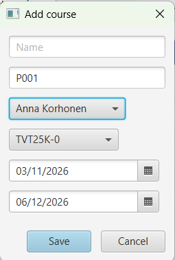 | 2 | Clearly mark required fields and validate input before form submission, or disable the Save button until all required fields are filled | Open |
| HE-17 | Login Page | H1-10: Help and documentation | No app description or context visible - a first-time user has no explanation of what EduJournal is or why they are logging in |  | 1 | Add a short tagline or subtitle below the app title | Open |
| HE-18 | All screens | H1-10: Help and documentation | The application does not provide built-in help or user documentation - new users have no guide explaining system features or how to perform common tasks                                                                                                       | 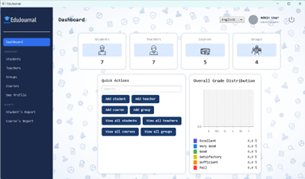 | 2 | Add a Help section or user guide with basic instructions and an overview of system features | Open |

---

## 5. Summary by Heuristic

| Heuristic | Findings Count | Highest Severity |
|---|:---:|:---:|
| H1-1 - Simple & natural dialog | 1 | 2 |
| H1-2 - Speak the users' language | 0 | - |
| H1-3 - Minimize users' memory load | 1 | 2 |
| H1-4 - Consistency | 2 | 2 |
| H1-5 - Feedback | 4 | 2 |
| H1-6 - Clearly marked exits | 3 | 2 |
| H1-7 - Shortcuts | 2 | 1 |
| H1-8 - Precise & constructive error messages | 1 | 2 |
| H1-9 - Prevent errors | 2 | 3 |
| H1-10 - Help and documentation | 2 | 2 |

---

## 6. Overall Assessment

**Total findings:** 18  
**Critical issues (severity 4):** 0  
**Major issues (severity 3):** 1 (HE-15 - Forgot Password without identity verification, fixed)  
**Minor/cosmetic issues (1–2):** 17

**General conclusion:** The application is functionally stable and covers all core use cases. The majority of usability issues are minor workflow gaps (missing feedback messages, inconsistent form behavior, missing cancel actions, absent keyboard shortcuts). One major security concern was identified around the password reset flow and addressed during the sprint. Seven issues found during evaluation (HE-03, HE-07, HE-08, HE-09, HE-10, HE-14, HE-15) were fixed immediately during the sprint.

---

## 7. Positive Observations

- **Role-based visual identity** - each role (Admin, Teacher, Student) has a distinct background and color scheme, making it immediately clear which role context the user is in.
- **Consistent sidebar navigation** - all pages share the same sidebar layout per role; users always know where they are and how to navigate.
- **Multilingual support** - the application supports four languages (English, Russian, Turkish, Arabic) switchable at any time from the top bar without requiring a logout.
- **Destructive action protection** - deleting an assessment that already has grades triggers a two-step confirmation dialog, preventing accidental data loss.
- **Searchable quick actions** - the dashboard quick-action panel has a live search filter, allowing fast access to any action without scrolling.
- **Export to PDF and CSV** - course and student reports can be exported to both formats directly from the report pages, making it easy to share or archive data outside the application.
- **Automatic final grade calculation** - the system calculates the weighted final grade automatically once all assessment scores are entered, reducing manual work and calculation errors.
- **All information in one place** - student grades, assessments, group membership, course details, and reports are all accessible within the application without switching between external tools.
- **Editable user profile** - all users can view and update their personal information (name, email, phone, date of birth for students) directly from the Own Profile page.
- **Inline grade editing** - the gradebook allows teachers to edit grades in place within the table without navigating to a separate page.
- **Comprehensive dashboard statistics** - the dashboard provides an at-a-glance overview of key metrics (total students, courses, groups, assessments) alongside a grade distribution chart, giving each role a meaningful summary of their data.

---

## 8. Recommendations Summary

Prioritized by severity - open issues only.

| Priority | ID | Severity | Recommendation |
|:---:|---|:---:|---|
| 1 | HE-06 | 2 | Show a success notification with the saved file path after CSV or PDF export completes |
| 2 | HE-05 | 2 | Add a brief status message after each create, edit, or delete action |
| 3 | HE-01 | 2 | Clearly mark required fields in course and group creation forms |
| 4 | HE-02 | 2 | Preserve entered data when a validation error occurs in course or group creation forms |
| 5 | HE-04 | 2 | Make all creation forms stay open consistently when a validation error occurs |
| 6 | HE-16 | 2 | Validate required fields before form submission or disable Save until all required fields are filled |
| 7 | HE-18 | 2 | Add a Help section or user guide with basic instructions and an overview of system features |
| 8 | HE-11 | 2 | Cancel button should return the user to the page from which they started the operation |
| 9 | HE-12 | 1 | Move focus to the password field when Enter is pressed in the username field |
| 10 | HE-13 | 1 | Submit the login form when Enter is pressed in the password field |
| 11 | HE-17 | 1 | Add a short tagline or subtitle below the app title on the login page to explain what EduJournal is |

> HE-03, HE-07, HE-08, HE-09, HE-10, HE-14, HE-15 were identified and fixed during this sprint.
